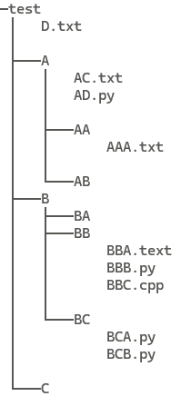
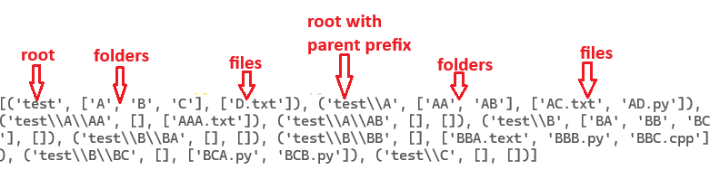

# Exercise 03: Inheritance and Trees 

Advanced Python Course  
Chalmers DAT690 / DIT516 / DAT516  
2026

by John J. Camilleri & Muhammad Mustafa Hassan

## Purpose

The session builds upon Lecture 4 and Lecture 5. We will:

- use inheritance to extend a graph class
- represent a directory structure as a tree
- visualize the tree and find its leaf nodes
- traverse the tree using depth first search.

This exercise targets learning objectives:

- **KU01** recognize all constructs of Python and the design choices behind them
- **SA04** use standard libraries for advanced tasks
- **SA05** apply testing methods to guarantee the quality of code

## 0. Background and preparation

In this exercise, we use a directory structure as an example of a tree. A directory can contain files and other directories, and each of these can be represented as a vertex. The connections between directories and their contents can be represented as edges.

We start with a `Graph` class and create a `Tree` class that inherits from it. We then read a directory structure, add its vertices and edges to our tree, and explore the tree using traversal.

#### NOTE for John: I think they better get a directory building function, instead of writing it themselves. So that their focus is centered on inheritance. 

**note**: the words *folder* and *directory* are interchangable.  

We need a function that reads the directory structre of a given folder. For example, if we want to read the following directory structure in our program: 



Please note that our top-level directory (also called **root**) in this tree is `test` and it contains `A`, `B` and `C` sub-directories, as well as a file named `D.txt`. Further, directories `B` and `C` also contain more files and folders. 

To read this directory structure, we import `os` library which provides multiple methods to read directory structure in a python program. Our current solution in the following uses `os.walk()` method. 

```python
import os 

def dir_list(path):
    return [(root, dirs, files) for root, dirs, files in os.walk(path)]

dirlist = dir_list('test')
```

The `os.walk()` method takes a path. For each directory on this `path` it returns a tuple (as shown in the diagram below) with following:
- `root`: current root directory
- `dirs`: directories in this root, and 
- `files`: files in this root directory 

**note**: For every subsequent root, `os.walk` prefixes the parent folder to directory name. We do not need this information for our subsequent tasks (and for simplicity we assume that no two dirs/files will have same name). Think how we can get rid of this information? You can see this pre-fixed name in the example diagram for our `test` folder:



**Task**: Remove the prefix from parent folder and merge dirs and files into one list.   
When you implement your own code, then see the following solution: 

SOLUTION 
```python
def dir_list(path=None):
    # depending upon your os, you may need to split on a different symbol 
    return [(root.split('\\')[-1], dirs + files) for root, dirs, files in os.walk(path)]
```

**Task**: Run `dir_list` several times with different paths to see if it returns the correct directory structure. You must use at least the following paths 

1. `.` (which means current directory) 
2. `..` (which means parent directory)
3. relative path of a directory of your own choice 
4. absolute path of a directory of your own choice 

## Create class `Tree`  that inherits from `Graph` 

Now, we have seen how directories on a computer are organized. They essentially form **tree** structures, which are a special type of graph. A **tree** is a graph that contains no cycles (loops) and in which every node is connected by exactly one path from the root.

For a reference, we use the following base `Graph` class

```python
import graphviz

class Graph:
    def __init__(self, adjdict=None):        
        self._adjdict = {}

    def add_vertex(self, a):
        self._adjdict.setdefault(a, set())

    def add_edge(self, a, b):
        self.add_vertex(a)
        self.add_vertex(b)

        a, b = sorted([a, b])
        self._adjdict.setdefault(a, set()).add(b)
        self._adjdict.setdefault(b, set()).add(a)

    def vertices(self):
        return set(self._adjdict.keys())

    def edges(self):
        return set( (a, b) for a,bs in self._adjdict.items()
            for b in bs if a <= b )

    def neighbors(self, n):
        return self._adjdict.get(n, set())
    
    def draw(self):
        dot = graphviz.Graph()

        for a in self.vertices():
            dot.node(str(a))

        for a,b in self.edges():
            dot.edge(str(a), str(b))

        dot.render('Graph', view=True)
```

A **root** is a special vertex in a tree that serves as the starting point of the structure. It is the only node that has no parent, and all other nodes in the tree descend from it, either directly or indirectly. Every node in the tree can be reached by following a unique path from the root. In a directory structure, for example, the root directory is the topmost directory from which all other files and directories originate. In our previous example diagram, _test_ is our root vertex. 

A **parent** node is any vertex in a tree that has one or more child nodes connected to it by edges. For example, in our directory diagram, vertex `A` is parent of vertices `AA`, `AB`, `AC.txt` and `AD.py` 

A **child** node is a vertex that is directly connected to and descends from a parent node. A parent can have zero, one, or multiple children. For example, in our directory diagram, vertices `BBA.text`, `BBB.py`, and `BCC.cpp.txt` are childern of vortex `BB`. 

A **leaf** node is a vertex in a tree that has no children. Leaf nodes are typically found at the ends of the tree's branches. Some examples of leaves in our directory structure diagram are `AAA.txt`, `BA`, and `C`. 

Now, we extend our `Graph` class by creating its child class `Tree` according to the following requirements:

1. `Tree` shall be able to designate one vertex as its **root**.
2. Every vertex except the root shall have exactly one parent. Root node does not has any parent 
3. Before adding an edge `(parent, child)` to the tree, we must verify that the child vertex does not already have a parent, and that `parent` already exist in our tree. 
4. Adding an edge shall not create a cycle (loop) in the tree.

Please note that the list of requirements for a Tree structure is not complete, but we keep these four requirements for simplicity.  

When you are done writing your `Tree` class, compare it with the following: 

SOLUTION 

```python
class Tree(Graph):
    def __init__(self, root):
        super().__init__()       
        self._adjdict = {root: set()}  

    def add_vertex(self, vertex):        
        raise ValueError("Standalone vertices can't be added to a Tree. Use add_edge(self, parent, child) method for additions")

    def add_edge(self, parent, child):
        if parent not in self._adjdict:
            raise ValueError("Parent does not exist")
        elif child in self._adjdict:
            raise ValueError("Child already exist")
        else:
            self._adjdict[parent].add(child)
            self._adjdict[child] = set()

    def edges(self):
        return { (parent, child) for parent, childern in self._adjdict.items() for child in childern }
```

In our `Tree` implementation, you must note the following:

1. `super().__init__()` calls `Graph.__init__()`, which creates `_adjdict` on the tree object. We then replace its empty dictionary with one containing `root` as the starting node. This implements our requirement 1.

2. We override `add_vertex` because `Graph().add_vertex` allows adding standalone vertices which is not allowed in case of `Tree`

3. We override `add_edge` because `Graph().add_edge` does not check for our requirements 2, 3 and 4 before adding an edge. 

4. We also override `edges` getter method, because we do not need `a<b` condition to remove redundancy. Our tree is already non-redundant by design. 

## Using our `dirlist` to populate `Tree` object 

Create a Tree object and use directory listing to populate it. Use the following guidelines: 

1. Tree shall be initialized with the root node, which is top most vertex. 
2. Each parent is connected to some childern in our example directory listing in a tuple, for example `('test', ['A', 'B', 'C', 'D.txt'])`. Here `test` is parent, and it has edges to childern `A`, `B`, `C` and `D.txt`. Therefore, the tree shall have exactly 4 edges for this example, each edge running from parent to one child. 
3. All parent-childern tuple of our `dirlist` shall be utlized to create edges in our tree. 

When you are done with implementing your own code, see the following implementation. 

SOLUTION
```python
if not dirlist:
    raise ValueError("Directory listing is empty; check the path")

root = dirlist[0][0]
dir_tree = Tree(root)

for parent, childern in dirlist:
    for child in childern:
        dir_tree.add_edge(parent, child)
```

## Add visualization to `Tree`

We want to see this directory tree in graphical view, as shown below:


Render your `Tree` with `graphviz.Graph()` to visualize it. 

**Question**: Do we need to override `Graph.draw()`, or we can use it from parent class? 

**Hint**: Think about "When do we need to override functionality in parent class? 

SOLUTION: 
We can use `Graph.draw()`. We do not need to override it in `Tree` because the rendering functionality does not change. 

## Add `leaves` getter to `Tree` class 

The `leaves` getter method returns all vertices which do not have a child. This is different than returning a list of vertices, or a list of edges. 

**Hint**: In our `Tree` class, each child is added to `Tree()._adjdict` as a key, and with an empty set as value. Therefore, leaves are those vertices which do not have any vertices in their child set. 

Implement your own version of `leaves` getter. Afterwards, see the following solution:

SOLUTION
```python
def leaves(self):
    return {vertex for vertex in self._adjdict if self._adjdict[vertex] == set()}
```

# Depth first search (DFS)

DFS is an algorithm which traverses a tree. 

Please note that DFS or BFS are traversal algorithms. They are not necessarily used exclusively to search for a vertex or an edge in a tree. They can be used to perform other functionalites also. Some examples may include: 

- visit every file and folder in a directory structure and print its name 
- search for a file/folder by name
- count total of files, total of folders, or both 

In DFS, we visit a vertex and then explore one of its children and that child's descendants before moving to another child.

**Task**: Add a `dfs` method to `Tree`. It shall take a starting vertex and return a list of all vertices visited from that vertex. Test it using the root of your directory tree.

SOLUTION
```python
def dfs(self, start):
    if start not in self._adjdict:
        raise ValueError("Starting vertex does not exist")

    visited = []

    def visit(vertex):
        visited.append(vertex)
        for child in self._adjdict[vertex]:
            visit(child)

    visit(start)
    return visited
```

```python
print(dir_tree.dfs(root))
```

`visit` adds the current vertex to the list and calls itself for each child. When a vertex has no children, the call returns and traversal continues with the next child. Since children are stored in sets, their visit order is not guaranteed. We do not need a separate visited check because our tree does not contain cycles.
