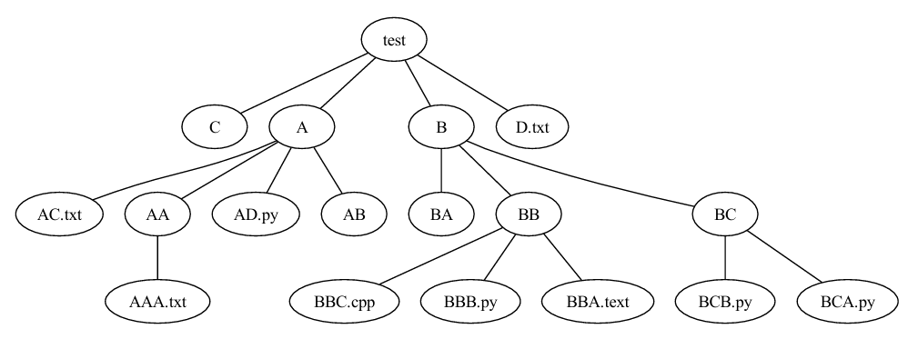

# Exercise 03: Inheritance and trees

Advanced Python Course  
Chalmers DAT690 / DIT516 / DAT516  
2026

by Muhammad Mustafa Hassan & John J. Camilleri

## Purpose

The session builds upon Lecture 4 and Lecture 5. We will:

- use inheritance to extend a graph class
- represent a directory structure as a tree
- visualize the tree and find its leaf nodes
- traverse the tree using depth first search

This exercise targets learning objectives:

- **KU01** recognize all constructs of Python and the design choices behind them
- **SA04** use standard libraries for advanced tasks
- **SA05** apply testing methods to guarantee the quality of code

## 0. Background and preparation

This exercise is primarily about **tree** structures, which are a special type of graph. A tree is a graph that contains no cycles (loops) and in which every node is connected by exactly one path from the root.

We will use a directory structure as an example of a tree. A directory can contain files and other directories, and each of these can be represented as a vertex in a graph. The connections between directories and their contents can be represented as edges.
**Note**: the terms *folder* and *directory* are interchangable.

In this exercise we start with a `Graph` class and create a `Tree` class that inherits from it. We'll then see how to read a directory structure, add its vertices and edges to our tree, and explore the tree using traversal.

For example, imagine you have the following directory structure on your computer:

```plain
test
├── D.txt
├── A
│   ├── AC.txt
│   ├── AD.py
│   ├── AA
│   │   └── AAA.txt
│   └── AB
├── B
│   ├── BA
│   ├── BB
│   │   ├── BBA.text
│   │   ├── BBB.py
│   │   └── BBC.cpp
│   └── B
│       ├── BCA.py
│       └── BCB.py
└── C
```

Our top-level directory (also called **root**) in this tree is `test` and it contains `A`, `B` and `C` sub-directories, as well as a file named `D.txt`. Directories `B` and `C` also contain more files and folders.

We first want a function that reads the directory structure of a given folder on our computer into a Python data structure.
To read this directory structure, we can import the `os` library which provides multiple methods to read directory structure in Python. For example this can be done with the `os.walk()` method like so:

```python
import os

def read_directory(path):
    return [(root, dirs, files) for root, dirs, files in os.walk(path)]

dir_list = read_directory('test')
```

The `os.walk()` method takes a path. For each directory on this path it returns a tuple (as shown below) with following:

- `root`: current root directory
- `dirs`: directories in this root
- `files`: files in this root directory

```python
[
  # root         dirs                files
  ('test',      ['A', 'B', 'C'],    ['D.txt']),
  ('test/A',    ['AA', 'AB'],       ['AC.txt', 'AD.py']),
  ('test/A/AA', [],                 ['AAA.txt']),
  ('test/A/AB', [],                 []),
  ('test/B',    ['BA', 'BB', 'BC'], []),
  ('test/B/BA', [],                 []),
  ('test/B/BB', [],                 ['BBA.text', 'BBB.py', 'BBC.cpp']),
  ('test/B/BC', [],                 ['BCA.py', 'BCB.py']),
  ('test/C',    [],                 []),
]
```

For every subsequent root, `os.walk()` prefixes the parent folder to directory name. We do not need this information for our subsequent tasks (and for simplicity we assume that no two dirs/files will have same name). Think how we can get rid of this information?

**Task**: Remove the prefix from parent folder and merge dirs and files into one list, so that we get something like the following:

```python
[
  ('test', ['A', 'B', 'C', 'D.txt']),
  ('A',    ['AA', 'AB', 'AC.txt', 'AD.py']),
  ('AA',   ['AAA.txt']),
  ('AB',   []),
  ('B',    ['BA', 'BB', 'BC']),
  ('BA',   []),
  ('BB',   ['BBA.text', 'BBB.py', 'BBC.cpp']),
  ('BC',   ['BCA.py', 'BCB.py']),
  ('C',    []),
]
```

<details markdown="1">
<summary>Show solution</summary>

```python
def read_directory(path=None):
    # depending upon your os, you may need to split on '\\' instead of '/'
    # for a more robust way of doing this, use os.path.split()
    return [(root.split('/')[-1], dirs + files) for root, dirs, files in os.walk(path)]
```

</details>

**Task**: Run `read_directory` several times with different paths on your system to see if it returns the correct directory structure. You must use at least the following paths:

1. `.` (which means current directory)
2. `..` (which means parent directory)
3. relative path of a directory of your own choice
4. absolute path of a directory of your own choice

## 1. Create class `Tree`  that inherits from `Graph`

Now, we have seen how directories on a computer are organized.
We are now going to build tree structures in Python to represent them.
As mentioned before, a tree is a special kind of graph, so our `Tree` class can inherit from `Graph`.

To start with, we use the following base `Graph` class as seen in the lectures:

```python
import graphviz

class Graph:
    def __init__(self, adjdict=None):
        self._adjdict = {}

    def add_vertex(self, a):
        self._adjdict.setdefault(a, set())

    def add_edge(self, a, b):
        self.add_vertex(a)
        self.add_vertex(b)
        a, b = sorted([a, b])
        self._adjdict[a].add(b)
        self._adjdict[b].add(a)

    def vertices(self):
        return set(self._adjdict.keys())

    def edges(self):
        return {
            (a, b)
            for a, bs in self._adjdict.items()
            for b in bs if a <= b
        }

    def neighbors(self, n):
        return self._adjdict.get(n, set())
    
    def draw(self):
        dot = graphviz.Graph()
        for a in self.vertices():
            dot.node(str(a))
        for a,b in self.edges():
            dot.edge(str(a), str(b))
        dot.render(view=True)
```

What makes trees different from regular graphs? Here is some additional terminology:

- A **root** is a special vertex in a tree that serves as the starting point of the structure. It is the only node that has no parent, and all other nodes in the tree descend from it, either directly or indirectly. Every node in the tree can be reached by following a unique path from the root. In a directory structure, for example, the root directory is the top-most directory from which all other files and directories originate. In our previous example diagram, `test` is our root vertex.

- A **parent** node is any vertex in a tree that has one or more child nodes connected to it by edges. For example, in our directory diagram, vertex `A` is parent of vertices `AA`, `AB`, `AC.txt` and `AD.py`

- A **child** node is a vertex that is directly connected to and descends from a parent node. A parent can have zero, one, or multiple children. For example, in our directory diagram, vertices `BBA.text`, `BBB.py`, and `BCC.cpp.txt` are children of vortex `BB`.

- A **leaf** node is a vertex in a tree that has no children. Leaf nodes are typically found at the ends of the tree's branches. Some examples of leaves in our directory structure diagram are `AAA.txt`, `BA`, and `C`.

Now, we extend our `Graph` class by creating its child class `Tree` according to the following requirements:

1. `Tree` shall be able to designate one vertex as its **root**.
2. Every vertex except the root shall have exactly one parent. Root node does not have any parent.
3. Before adding an edge `(parent, child)` to the tree, we must verify that the child vertex does not already have a parent, and that `parent` already exists in our tree.
4. Adding an edge shall not create a cycle (loop) in the tree.

Note that the list of requirements for a tree structure is not complete, but we keep these four requirements for simplicity.

**Task**: Implement the `Tree` class as described above.

<details markdown="1">
<summary>Show solution</summary>

```python
class Tree(Graph):
    def __init__(self, root):
        super().__init__()
        self._adjdict = {root: set()}

    def add_vertex(self, vertex):
        raise NotImplementedError("Standalone vertices can't be added to a Tree, use add_edge() instead")

    def add_edge(self, parent, child):
        if parent not in self._adjdict:
            raise ValueError("Parent does not exist")
        elif child in self._adjdict:
            raise ValueError("Child already exists")
        else:
            self._adjdict[parent].add(child)
            self._adjdict[child] = set()

    def edges(self):
        return {
            (parent, child)
            for parent, children in self._adjdict.items()
            for child in children
        }
```

In our `Tree` implementation, note the following:

1. `super().__init__()` calls `Graph.__init__()`, which creates `_adjdict` on the tree object. We then replace its empty dictionary with one containing `root` as the starting node.
In this example the call to `super().__init__()` is not technically needed here, but it's a good convention to do so anyway. This implements our requirement 1.

2. We override `add_vertex()` because `Graph().add_vertex()` allows adding standalone vertices which is not allowed in case of `Tree`.

3. We override `add_edge()` because `Graph().add_edge()` does not check for our requirements 2, 3 and 4 before adding an edge.

4. We also override the `edges()` getter method, because we do not need the `a <= b` condition to remove redundancy. Our tree is already non-redundant by design.

</details>

## 2. Using our directory list to populate `Tree` object

**Task**: Now we want to create a `Tree` object and use a directory listing to populate it. Use the following guidelines:

1. `Tree` shall be initialized with the root node, which is top-most vertex.
2. Each parent is connected to some children in our example directory listing in a tuple, for example `('test', ['A', 'B', 'C', 'D.txt'])`. Here `test` is parent, and it has edges to children `A`, `B`, `C` and `D.txt`. Therefore, the tree shall have exactly 4 edges for this example, each edge running from parent to one child.
3. All parent-children tuples of our `dir_list` shall be used to create edges in our tree.

When you are done with implementing your own code, see the following implementation.

<details markdown="1">
<summary>Show solution</summary>

```python
if not dir_list:
    raise ValueError("Directory listing is empty; check the path")

root = dir_list[0][0]
dir_tree = Tree(root)

for parent, children in dir_list:
    for child in children:
        dir_tree.add_edge(parent, child)
```

</details>

## 3. Add visualization to `Tree`

We want to be able to visualise this directory tree graphically like so:



**Question**: Do we need to override `Graph.draw()`, or we can use it from parent class?

*Hint: Think about "When do we need to override functionality in parent class?"*

<details markdown="1">
<summary>Show solution</summary>

We can use `Graph.draw()`. We do not need to override it in `Tree` because the rendering functionality does not change.

</details>

## 4. Add `leaves()` getter to `Tree` class

The `leaves()` getter method returns all vertices which do not have a child. This is different than returning a list of vertices, or a list of edges.

**Task**: Implement your own version of `leaves()` getter.

*Hint: In our `Tree` class, each child is added to `Tree._adjdict` as a key, and with an empty set as value. Therefore, leaves are those vertices which do not have any vertices in their child set.*

<details markdown="1">
<summary>Show solution</summary>

```python
def leaves(self):
    return {
        vertex
        for vertex in self._adjdict
        if self._adjdict[vertex] == set()
    }
```

</details>

## 5. Traversing the tree

**Depth-first search (DFS)** and **breadth-first search (BFS)** are traversal algorithms for trees. They are not necessarily used exclusively to search for a vertex or an edge in a tree. They can be used to perform other functionalites also. Some examples may include:

- visit every file and folder in a directory structure and print its name
- search for a file/folder by name
- count total of files, total of folders, or both

In DFS, we visit a vertex and then explore one of its children and that child's descendants before moving to another child.

**Task**: Add a `dfs()` method to `Tree`. It shall take a starting vertex and return a list of all vertices visited from that vertex. Test it using the root of your directory tree.

<details markdown="1">
<summary>Show solution</summary>

```python
def dfs(self, start):
    if start not in self._adjdict:
        raise ValueError("Starting vertex does not exist")

    visited = []

    def visit(vertex):
        visited.append(vertex)
        for child in self._adjdict[vertex]:
            visit(child)

    visit(start)
    return visited
```

The locally-defined `visit()` function adds the current vertex to the list and calls itself for each child. When a vertex has no children, the call returns and traversal continues with the next child. Since children are stored in sets, their visit order is not guaranteed. We do not need a separate visited check because our tree does not contain cycles.

</details>
